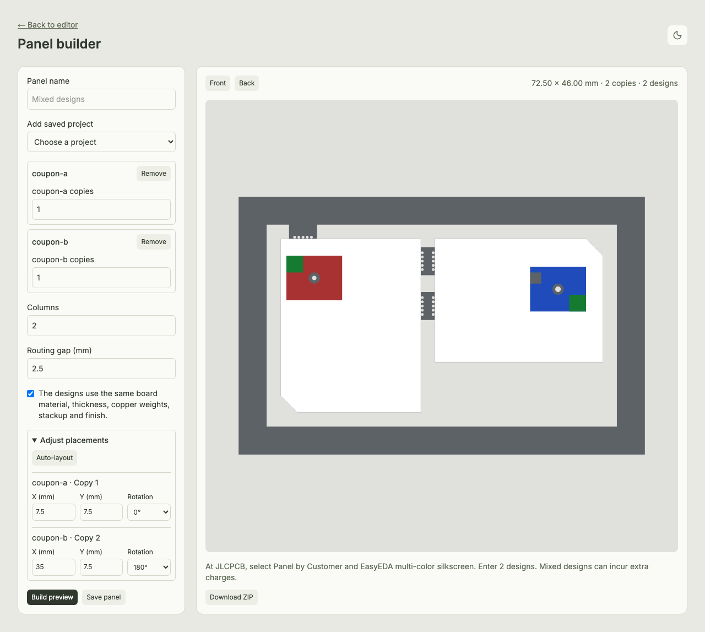

# Synthetic panel coupons

`coupon-a.overprint` and `coupon-b.overprint` are self-contained Overprint projects from the synthetic `source-a.kicad_pcb` and `source-b.kicad_pcb` test boards, plotted in KiCad 10. Their embedded files are the CAM inputs for the panel tests.

- A is 25 × 31 mm and includes a 0.8 mm plated drill. Its red artwork has an asymmetric green corner on both sides.
- B is 30 × 22 mm, has a clipped corner and a 1 mm plated drill. Its blue artwork has an asymmetric green corner and a separate front ENIG patch.
- `cam_checks.py` adds synthetic Gerber and drill commands for rotated apertures, outline arcs and gaps, slotted drills, and rejection cases.

The browser tests create a two-copy panel from A and a two-design panel with B rotated 180°. They exercise browser rendering and file alignment. Physical registration and breakaway require a fabricated sample.

## JLCPCB quote-page check

On 9 November 2026, two synthetic ZIPs from the standalone build at `55d4992` were uploaded through the quote page.

| Coupon | Panel size | SHA-256 |
| --- | --- | --- |
| Two copies of A | 67.5 × 46 mm | `e01d35d4c28c863aa5ec01b52973438ea1e20cab2a055d121a3883d505e01b38` |
| A and B, with B rotated 180° | 72.5 × 46 mm | `3ba6cb9237582044f5325255ff08326941db72531e8d6ca5b325f39fa10a3d34` |

The quote page loaded both board outlines and dimensions. It offered Panel by Customer and EasyEDA multi-color silkscreen. Opening the detailed Gerber Viewer required a JLCPCB sign-in, including for the public EasyEDA Pro color stamp-hole control. The authenticated front/back review remains open. Physical ink orientation, registration, and breakaway require sample fabrication. [Viewer validation issue](https://github.com/Dirdmaster/overprint/issues/55)

